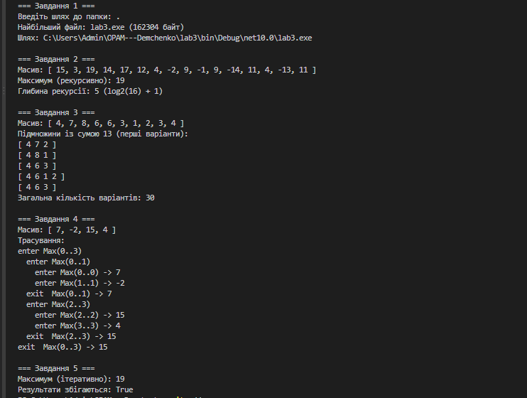

# ЗВІТ

### з лабораторної роботи №3

**з дисципліни «Основи програмування та алгоритмічні мови»**

**Тема:** Рекурсивні алгоритми

**Студент:** Демченко В'ячеслав

**Група:** КН-3/1

---

**Параметри варіанта:**

`N = 6, K = 3, a = 0, b = 2, c = 1`

---

## 1. Опис базових випадків рекурсії

* **Завдання 1:** Базовим випадком є ситуація, коли поточна папка не містить жодних вкладених підпапок (цикл рекурсивного обходу піддиректорій не виконується).
* **Завдання 2:** Базовим випадком є ситуація, коли підмасив скоротився до одного елемента (`lo == hi`), і функція повертає саме це значення.
* **Завдання 3:** Базовими випадками є досягнення суми 13 (`targetSum == 0`), що викликає вивід підмножини, або вихід за межі масиву чи від'ємна залишкова сума (`index >= arr.Length` або `targetSum < 0`).
* **Завдання 4:** Базовим випадком є досягнення діапазону з одного елемента (`lo == hi`), де друкується вхід і одразу повертається значення.

---

## 2. Результати виконання програми



---

## 3. Вивід трасування (Завдання 4)

```text
enter Max(0..3)
  enter Max(0..1)
    enter Max(0..0) -> 7
    enter Max(1..1) -> -2
  exit  Max(0..1) -> 7
  enter Max(2..3)
    enter Max(2..2) -> 15
    enter Max(3..3) -> 4
  exit  Max(2..3) -> 15
exit  Max(0..3) -> 15

```

**Пояснення порядку виходу:**

Рядки `exit` з'являються у зворотному порядку до `enter`, тому що стек викликів працює за принципом LIFO (Last In, First Out). Функція може завершити виконання та вийти тільки після того, як повністю завершаться всі її вкладені рекурсивні виклики.

---

## 4. Відповіді на питання (Завдання 5)

1. **Який запис зрозуміліший для задачі пошуку максимуму:**
Для знаходження максимуму в лінійному масиві значно зрозумілішим та ефективнішим є циклічний запис. Він має просту логіку $O(N)$, виконує один прохід без додаткових витрат пам'яті на стек викликів і не потребує ускладнення коду поділом на межі.
2. **Чому переписати циклом Завдання 1 не так просто:**
Переписати обхід каталогу циклом складніше, тому що папки мають довільну вкладену деревоподібну структуру. Цикл сам по собі не має пам'яті про те, на якому рівні вкладеності він перебуває і які підпапки ще залишилися необробленими. Для ітеративного обходу обов'язково знадобиться явна допоміжна структура даних — **Стек (Stack)** або **Черга (Queue)** для збереження шляхів незавершених директорій.

---

## 5. Таблиця перевірки крайових випадків

| Вхід | Завд. | Очікувано | Отримано | Виправлення |
| --- | --- | --- | --- | --- |
| **Порожня папка** | 1 | Повертає `null` без помилок | `null` (файлів немає) | Додано перевірку на наявність файлів |
| **Заборонена папка** | 1 | Пропуск папки без падіння | Помилка перехоплена, обхід продовжено | `try-catch UnauthorizedAccessException` |
| **Масив з 1 елемента** | 2 | Повертає цей єдиний елемент | Елемент повернуто | Працює базовий випадок `lo == hi` |
| **Усі елементи однакові** | 2 | Повертає це значення | Повернуто правильне значення | Коректне порівняння `left > right` |
| **Варіантів не існує** | 3 | Повертає 0 варіантів | 0 знайдено | Працює умова `targetSum < 0` |
